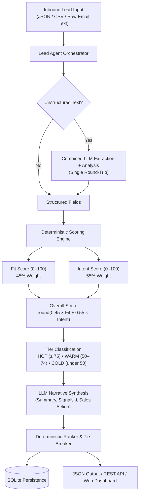

# Lead Qualification Agent 🎯

A production-grade, end-to-end AI agent system for qualifying inbound sales leads. The agent analyzes structured forms, sales notes, or raw email text, deterministically scores each lead on **Fit** and **Intent**, classifies them into **HOT**, **WARM**, or **COLD** tiers, and generates actionable, evidence-based recommendations so sales teams know **who to call first**.

---

## 📌 Problem

Sales teams often receive hundreds of inbound leads daily through web forms, emails, and campaign responses. Reps waste critical time manually reviewing unstructured inquiries, leading to delayed responses for urgent high-value leads and missed conversion opportunities. Generic LLM scoring engines are prone to hallucinations, non-reproducible score volatility, and invented budgets or timelines.

## 💡 Solution

The **Lead Qualification Agent** solves this by decoupling numerical scoring from generative narrative synthesis:

1. **100% Deterministic Scoring Engine** - Fit Score (0–100 across 5 business categories) and Intent Score (0–100 across 5 engagement categories) are calculated with transparent rule logic. No LLM touches the numbers.
2. **Zero-Hallucination LLM Rationale** - The LLM is strictly restricted to extracting missing properties from raw text and generating tailored sales actions. Missing information is explicitly reported as `"Not provided"`.
3. **Deterministic Ranking & Tie-Breaking** - Leads are ranked by score with a multi-step tie-breaker, guaranteeing a consistent, prioritized outreach queue every run.

---

## 🏗️ Architecture



---

## 📊 Scoring Logic

Overall score formula:

$$\text{Overall Score} = \text{round}\left( (\text{Fit Score} \times 0.45) + (\text{Intent Score} \times 0.55) \right)$$

Intent is weighted slightly higher (55%) because high immediate intent warrants faster sales response, regardless of company size.

### 1. FIT SCORE (0–100)
Evaluates how closely the lead matches the ideal customer profile (ICP):

| Dimension | Max | Criteria |
|---|:---:|---|
| Company / Industry | 25 | High-target (B2B SaaS, AI, Cloud, DeepTech) = 25; Medium (Manufacturing, Logistics, Finance) = 18; Low (Retail, Hospitality) = 10; Unknown = 5 |
| Company Size | 20 | Enterprise 500+ = 20; Mid-Market 100–499 = 16; Growing SMB 20–99 = 12; Micro SMB 1–19 = 6; Unknown = 0 |
| Decision Authority | 20 | C-Level/VP/Founder = 20; Director/Manager = 15; Senior IC = 10; Entry/Student = 3; Unknown = 5 |
| Budget | 20 | ≥$50k = 20; $20k–$49.9k = 16; $5k–$19.9k = 10; <$5k = 4; Unknown = 0 |
| Geography | 15 | Tier 1 (US, UK, CA, AU, DE, IN) = 15; Tier 2 = 10; Other = 6; Unknown = 5 |

### 2. INTENT SCORE (0–100)
Evaluates urgency and buying engagement:

| Dimension | Max | Criteria |
|---|:---:|---|
| Product Interest | 25 | Specific named solution = 25; General interest = 15; Vague = 8; Missing = 0 |
| Purchase Timeline | 25 | Within 30 days = 25; 1–3 months = 18; 3–6 months = 10; 6+ months = 4; No timeline = 0 |
| Requirements / Questions | 20 | Detailed technical requirements = 20; Basic questions = 12; Minimal = 5; Unknown = 0 |
| Demo / Pricing Request | 15 | Explicit demo or pricing request = 15; Inbound form = 10; Content download = 5; Unknown = 0 |
| Urgency Signals | 15 | Strong ("budget approved", "evaluating 3 vendors") = 15; Moderate = 10; Negative (student, no project) = 0 |

### 3. Lead Tiers

| Tier | Threshold |
|---|---|
| 🔥 **HOT** | Overall Score ≥ 75 |
| ⚡ **WARM** | 50 ≤ Overall Score < 75 |
| ❄️ **COLD** | Overall Score < 50 |

Thresholds are configurable in `.env` via `HOT_THRESHOLD` and `WARM_THRESHOLD`.

---

## 🏆 Ranking & Tie-Breaking

When qualifying a batch, leads are sorted descending by:

1. **Overall Score**
2. **Intent Score**
3. **Purchase Timeline urgency sub-score**
4. **Explicit demo/pricing request** (True before False)
5. **Lead ID** (alphabetical — ensures deterministic reproducibility)

---

## 📦 Project Structure

```
Lead Qualification Agent/
│
├── app/
│   ├── __init__.py
│   ├── main.py          # FastAPI application & REST endpoints + web dashboard
│   ├── config.py        # Pydantic Settings & threshold configuration
│   ├── models.py        # SQLAlchemy ORM model for SQLite persistence
│   ├── schemas.py       # Pydantic validation schemas
│   ├── scoring.py       # Deterministic scoring engine & tie-breaker ranker
│   ├── prompts.py       # System prompts & anti-hallucination templates
│   ├── llm.py           # LLM client, combined extraction+analysis, fallback
│   ├── agent.py         # LeadQualificationAgent orchestrator
│   ├── database.py      # SQLite connection & CRUD repository
│   └── utils.py         # CSV/JSON file loaders & CLI formatters
│
├── data/
│   ├── sample_leads.json  # 10 diverse sample leads (HOT/WARM/COLD)
│   ├── sample_leads.csv   # CSV version of sample leads
│   └── test_leads.csv     # 12-lead test dataset with unstructured email rows
│
├── tests/
│   ├── __init__.py
│   ├── test_scoring.py    # Unit tests for scoring engine & thresholds
│   ├── test_agent.py      # Tests for agent orchestration & batching
│   └── test_api.py        # Tests for FastAPI REST endpoints
│
├── outputs/               # JSON qualification results (git-ignored)
├── requirements.txt       # Python dependencies
├── .env.example           # Environment variable template
├── run.py                 # CLI entrypoint
└── README.md
```

---

## ⚙️ Installation & Setup

### Prerequisites
- Python 3.11+
- An OpenAI-compatible API key (Groq, OpenAI, etc.) — optional; system runs fully offline without one.

### 1. Clone & Set Up Virtual Environment
```bash
git clone https://github.com/abhig-17/Lead_Qualification_Agent
cd Lead_Qualification_Agent

python -m venv venv
# Windows:
venv\Scripts\activate
# macOS / Linux:
source venv/bin/activate
```

### 2. Install Dependencies
```bash
pip install -r requirements.txt
```

### 3. Configure Environment Variables
```bash
cp .env.example .env
```

Edit `.env`:
```env
# LLM provider — leave blank to run in offline fallback mode
OPENAI_API_KEY=your_api_key_here
MODEL_NAME=gpt-4o-mini

# For Groq (example):
# OPENAI_BASE_URL=https://api.groq.com/openai/v1
# MODEL_NAME=llama-3.1-8b-instant

DATABASE_URL=sqlite:///./leads.db
HOT_THRESHOLD=75
WARM_THRESHOLD=50
```

---

## 🚀 Running the Application

### 1. Web Dashboard & REST API
```bash
python -m uvicorn app.main:app --reload --port 8000
```

Open in your browser:
- **Interactive Dashboard**: `http://localhost:8000`
- **Swagger API Docs**: `http://localhost:8000/docs`
- **ReDoc**: `http://localhost:8000/redoc`

### 2. CLI Batch Runner
```bash
# Run on default sample dataset
python run.py

# Run on a custom file
python run.py --file data/test_leads.csv --output outputs/my_output.json
```

### 3. Automated Tests
```bash
pytest
```

---

## 📡 API Reference

### `GET /health`
```json
{ "status": "ok" }
```

### `POST /qualify`
Qualifies a single lead. Accepts both structured fields and/or raw `email_text` / `notes`.

```json
{
  "name": "Sarah Johnson",
  "company": "Acme SaaS",
  "job_title": "VP Engineering",
  "industry": "B2B SaaS",
  "company_size": 200,
  "location": "United States",
  "budget": "$50,000",
  "interest": "AI automation platform",
  "timeline": "Within 30 days",
  "notes": "We are evaluating three vendors and would like a demo and pricing ASAP."
}
```

Also accepts raw email with no structured fields:
```json
{
  "email_text": "Hi, I'm Sarah, VP Eng at Acme SaaS. We have a $50k budget and need an AI tool within 30 days. Please send demo details."
}
```

### `POST /qualify/batch`
Qualifies a list of leads and returns deterministically ranked results.

### `GET /leads`
Returns all stored qualification records ordered by rank.

### `GET /leads/{lead_id}`
Returns a specific qualification record by lead ID.

### `DELETE /leads/{lead_id}`
Deletes a lead record.

---

## 📑 Sample Output

```json
{
  "total_leads": 10,
  "hot": 5,
  "warm": 3,
  "cold": 2,
  "leads": [
    {
      "lead_id": "L001",
      "name": "Sarah Johnson",
      "company": "Acme SaaS",
      "job_title": "VP Engineering",
      "rank": 1,
      "fit_score": 96,
      "intent_score": 90,
      "overall_score": 93,
      "tier": "HOT",
      "summary": "VP Engineering at Acme SaaS (B2B SaaS, 200 employees, US) has requested a product demo and pricing for an AI automation platform with a $50,000 budget within 30 days.",
      "buying_signals": [
        "Explicit request for product demo",
        "Requested pricing / quote details",
        "Urgent purchase timeline (< 30 days)",
        "Active vendor evaluation in progress",
        "High-authority decision maker (VP Engineering)",
        "Strong budget compatibility ($50,000)"
      ],
      "risk_signals": [],
      "reasoning": "Fit Score (96/100) based on industry relevance (25/25), company size (16/20), decision authority (20/20), budget (20/20), and location (15/15). Intent Score (90/100) based on product interest (25/25), timeline (25/25), requirements (10/20), contact request (15/15), and urgency (15/15). Overall Score = round(0.45 × 96 + 0.55 × 90) = 93 [HOT].",
      "recommended_action": "Schedule a personalized demo call today. Prepare a pricing proposal aligned with the $50k budget and 30-day decision timeline.",
      "confidence": 0.95
    }
  ]
}
```

---

## 🎯 Design Decisions

**Why deterministic scoring instead of LLM-generated numbers?**
Prompting an LLM for a numerical score introduces high variance, non-reproducibility, and vulnerability to hallucinated budgets or timelines. By separating scoring into a rule engine and using the LLM strictly for natural language narrative, the system achieves 100% explainability and zero score hallucination.

**Why weight Intent (55%) higher than Fit (45%)?**
A high-fit enterprise lead with no purchase timeline should not displace a smaller SMB lead that needs deployment in 30 days and has already requested a demo. Intent reflects immediate revenue velocity.

**Why a combined LLM call for unstructured leads?**
Leads with raw `email_text` or `notes` previously needed two sequential LLM calls (extraction → analysis). The combined `extract_and_analyze_combined()` function does both in a single round-trip, halving API latency for those leads.

**Offline fallback architecture:**
If no API key is present or the LLM times out, the system falls back to regex-based extraction and template-based narrative generation — guaranteeing 0% crash rate in all network conditions.

---

## ⚖️ Tradeoffs & Limitations

- **Rule precision vs. generalization** — Hardcoded thresholds (e.g. $50k = 20 pts) are consistent but may need tuning for different product price points.
- **Static keyword lists** — Buying and risk signal extraction relies on predefined dictionaries that may need updating for niche industries.
- **No real-time enrichment** — Missing company data (size, location) is not auto-filled via external APIs (e.g. Clearbit, LinkedIn).
- **Single ICP model** — Scoring assumes one product/service profile. Multi-product enterprises would need per-product weight configurations.

---

## 🔮 Future Improvements

1. **CRM Integrations** — Bi-directional sync with Salesforce, HubSpot, and Pipedrive to trigger SDR tasks automatically.
2. **ML-Tuned Weights** — Train a lightweight model on historical closed-won deals to dynamically adjust category weightings.
3. **Third-Party Enrichment** — Auto-fill firmographic gaps via ZoomInfo / Clearbit when company fields are missing.
4. **Multi-ICP Configuration** — Dynamic scoring profiles selectable per business unit or product line.
5. **Human-in-the-Loop Feedback** — Sales rep "Agree / Disagree" buttons to continuously refine signal extraction.
